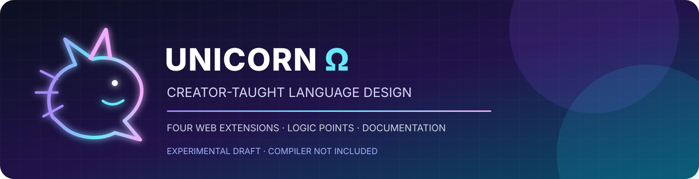
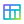
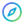

<div align="center">



# 🦄 UNICORN Ω
### Bahasa pemrograman yang dibangun selangkah demi selangkah bersama penciptanya


**Satu proyek. Empat ekstensi utama. Aturan ditambahkan hanya setelah diajarkan dan disetujui pencipta.**

[Mulai dari sini](docs/30-unicorn-omega/README.md) · [Aturan yang sudah diajarkan](docs/30-unicorn-omega/creator-taught-rules.md) · [Contoh](examples/06-creator-taught-syntax/README.md) · [Status pengujian](TESTING.md) · [Siapkan GitHub](PUSH-TO-GITHUB.md)

</div>

---

## ✨ Apa itu UNICORN Ω?

UNICORN Ω adalah proyek bahasa pemrograman yang sedang dirancang. Repositori ini mendokumentasikan aturan yang telah diajarkan penciptanya, contoh, pertanyaan yang belum diputuskan, dan proses validasi dokumentasi.

> [!IMPORTANT]
> **Bahasa ini belum dinyatakan matang, stabil, atau siap produksi.** ZIP ini tidak menyertakan compiler atau runtime resmi. Contoh UNICORN Ω di sini adalah bahan spesifikasi dan belum dapat diklaim berhasil dijalankan. Status pemeriksaan dokumentasi juga tidak sama dengan persentase kesiapan bahasa.

> [!NOTE]
> **Aturan resmi di repositori ini dibatasi pada aturan yang sudah diajarkan pencipta.** Materi lama pada bagian lain (`docs/00`–`docs/29`) adalah catatan proposal/riset awal. Materi tersebut tidak otomatis menjadi sintaks resmi dan tidak boleh digunakan untuk menambahkan aturan baru tanpa persetujuan pencipta.

## 🧭 Empat ekstensi utama

<div align="center">

| Ekstensi | Peran yang telah dijelaskan | Status sintaks |
|:---:|---|---|
|  **`.unml`** | Struktur halaman website | Aturan rinci belum diajarkan |
|  **`.uncs`** | Gaya dan tampilan website | Aturan rinci belum diajarkan |
|  **`.untext`** | Logika dan interaksi | Contoh awal sudah diberikan; belum diuji compiler |
|  **`.unt`** | Data website | Aturan rinci belum diajarkan |

</div>

Penjelasan status lengkap: **[Peta ekstensi](docs/30-unicorn-omega/extensions.md)**. Bagian yang belum diajarkan sengaja tidak diisi dengan sintaks karangan.

## 🧠 Logika yang sudah diajarkan

| Bentuk | Penggunaan yang sudah dicontohkan | Catatan |
|---|---|---|
| `persamaan= "WhatsApp",` | Point untuk logika `#sama#` ketika dipakai sendiri | Mengikuti contoh pencipta |
| `pencocokan= "WhatsApp",` | Point untuk logika `#hampir#` ketika dipakai sendiri | Mengikuti contoh pencipta |
| `objek::(WhatsApp):,` | Bentuk objek dalam contoh logika tunggal | Semantik compiler belum diuji |
| `kenyataan::a:,` | Penghubung pada contoh logika tunggal | Mengikuti contoh pencipta |
| `maka#sama#dengan::WeChat,` | Contoh logika `#sama#` | Makna formal lengkap masih dalam pengembangan |
| `maka#hampir#dengan::WeChat,` | Contoh logika `#hampir#` untuk pencocokan | Makna formal lengkap masih dalam pengembangan |
| `maka#persis#dengan::WeChat,` | Diajarkan sebagai bagian dari contoh gabungan dengan `#sama#` | Bentuk tunggal belum ditetapkan di dokumentasi ini |

Untuk aturan gabungan, point, dan batas yang belum diputuskan, baca **[aturan pencipta](docs/30-unicorn-omega/creator-taught-rules.md)**.

## 🧪 Status pengujian — bukan klaim kematangan

<div align="center">


</div>

Angka **50%** hanya merujuk pada **5 dari 10 butir matriks validasi yang mempunyai pemeriksaan otomatis atau dokumentasi awal**. Ini **bukan** 50% test coverage bahasa, bukan persentase fitur selesai, dan bukan bukti compiler bekerja. Belum ada hasil uji runtime karena compiler/runtime resmi belum tersedia.

Jalankan pemeriksaan repositori:

```bash
python -m unittest discover -s tests -v
```

Lihat hasil, batas pemeriksaan, dan lima pengujian yang masih menunggu implementasi pada **[TESTING.md](TESTING.md)**.

## 🧩 Peta dokumentasi

 **Kanon dan aturan pencipta**

- [Mulai di sini](docs/30-unicorn-omega/README.md)
- [Aturan yang telah diajarkan](docs/30-unicorn-omega/creator-taught-rules.md)
- [Empat ekstensi](docs/30-unicorn-omega/extensions.md)
- [Status aturan, istilah dan pertanyaan terbuka](docs/30-unicorn-omega/open-questions.md)
- [Daftar library](docs/30-unicorn-omega/library-registry.md) · [Folder library](libraries/README.md)
- [Contoh yang mengikuti aturan](examples/06-creator-taught-syntax/README.md)
- [Proyek contoh Play Store](examples/07-play-store-project/README.md)

 **Dokumen fondasi dan riset awal**

- [Indeks seluruh dokumentasi](docs/index.md)
- [Inventaris file](FILE-INVENTORY.md)
- [Roadmap](ROADMAP.md)
- [Perubahan](CHANGELOG.md)
- [Status proyek](STATUS.md)

Dokumen lama yang membahas compiler, memori, API, backend, hardware, atau library lebih jauh harus dianggap **proposal yang belum disahkan**, kecuali pencipta menetapkannya secara eksplisit.

## 🎨 Identitas repositori

- Palet visual: midnight navy, violet, cyan, dan lime.
- Ikon SVG lokal berada di `assets/icons/` dan dapat dipakai pada README maupun dokumentasi GitHub.
- Nama proyek: **UNICORN Ω**.
- Metadata author/studio yang sudah tercantum di arsip: `vianarasya` / `Viana Studio`.

Lihat katalog ikon pada [assets/icons/README.md](assets/icons/README.md).

## 🤝 Aturan kontribusi

1. Jangan menambahkan sintaks, keyword, fungsi, library, atau perilaku baru sebelum pencipta mengajarkannya atau menyetujuinya.
2. Pisahkan **aturan yang diajarkan**, **contoh yang belum diuji**, **proposal**, dan **fitur yang benar-benar diimplementasikan**.
3. Jangan menyebut bahasa matang, stabil, aman, cepat, kompatibel, atau siap produksi tanpa bukti yang sesuai.
4. Pertahankan contoh asli saat mengarsipkan aturan; koreksi harus memiliki alasan dan persetujuan.
5. Jangan menambahkan dependensi library sebagai standar sebelum nama, fungsi, parameter, hasil, dan perilaku error diajarkan.

Baca [CONTRIBUTING.md](CONTRIBUTING.md) sebelum mengubah repositori.

## 📦 Lisensi

Status lisensi masih belum final. Jangan menganggap repositori ini memiliki lisensi open-source tertentu sampai [LICENSE-STATUS.md](LICENSE-STATUS.md) diselesaikan.

---

<div align="center">

**UNICORN Ω · dokumentasi yang tumbuh bersama aturan penciptanya**

<sub>Dokumentasi yang rapi bukan pengganti compiler, spesifikasi normatif, atau pengujian eksekusi.</sub>

</div>
