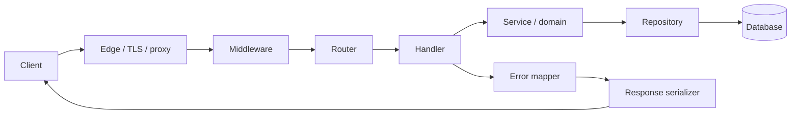

# Arsitektur API Server

Lapisan transport tidak seharusnya memuat seluruh business logic. Handler validasi format dan mengubah HTTP menjadi command/query domain; service melakukan aturan bisnis; repository menangani detail penyimpanan.

## Tanggung jawab

- Edge: TLS, connection limits, request size, forwarded headers yang tervalidasi.
- Middleware: request ID, authn/authz, rate limit, observability.
- Router: method/path match.
- Handler: schema validation, response code.
- Service: aturan domain dan transaction boundaries.
- Repository: query parametrik dan pengelolaan database.
- Error mapper: public error code yang stabil, tanpa stack trace.
